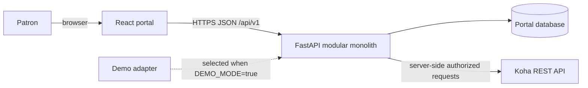
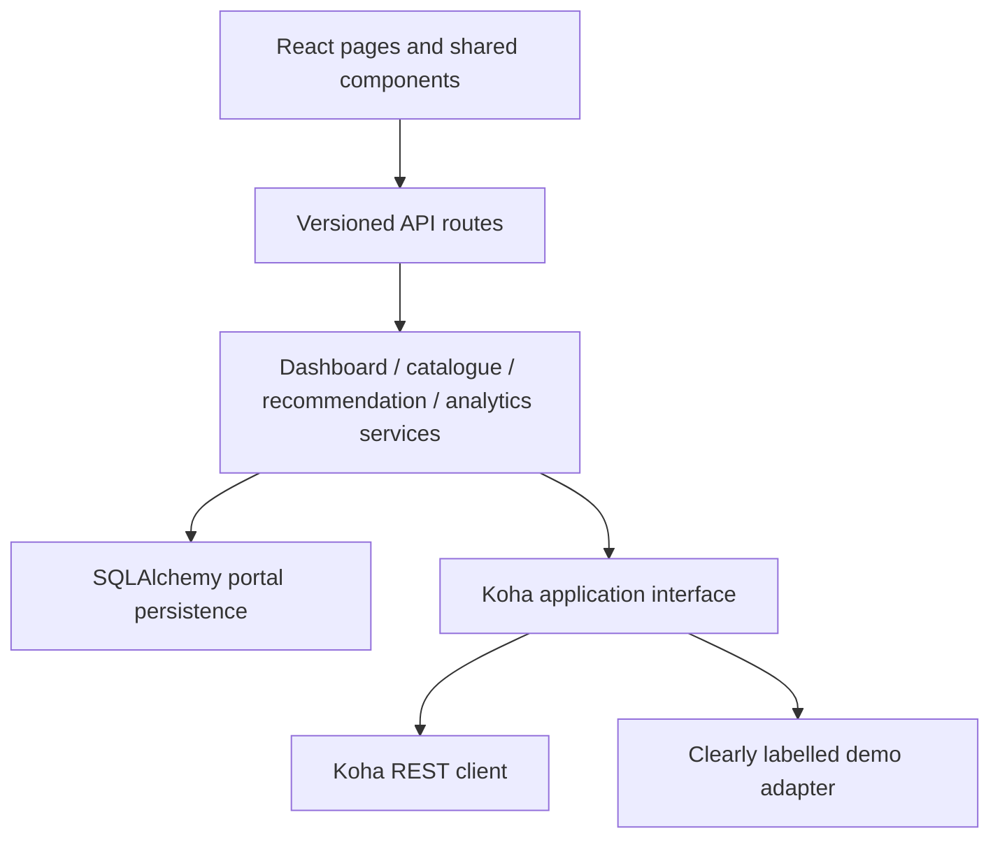
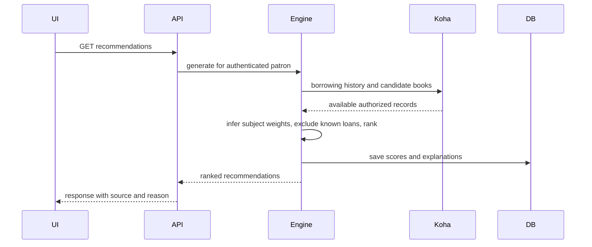

# Architecture

The portal is a modular monolith: React/Vite talks only to a versioned FastAPI API. The API owns mapping, recommendations and portal preferences; Koha remains the system of record. SQLAlchemy persists user interests and generated recommendation metadata. SQLite is the local default and can be replaced with PostgreSQL using `DATABASE_URL`.

## System context and deployment

Deployment topology beyond the local development setup is proposed, not verified. TLS termination, database hosting, and Koha network access depend on the target library environment.

## Components

The implementation preserves the UML responsibilities (patron/User, catalogue Book, borrowing records, interests, strategy recommendations, analysis service, Koha client, dashboard widgets) without one class per diagram box. Since the source diagrams were not supplied, UML mapping is provisional and based on the written brief.

## Recommendation sequence

The demo vertical slice implements explainable subject overlap and a new-arrival/availability fallback. Live patron resolution, persistence of generated records, caching, and pagination across Koha responses remain to be wired after deployment-specific auth and endpoint verification.
