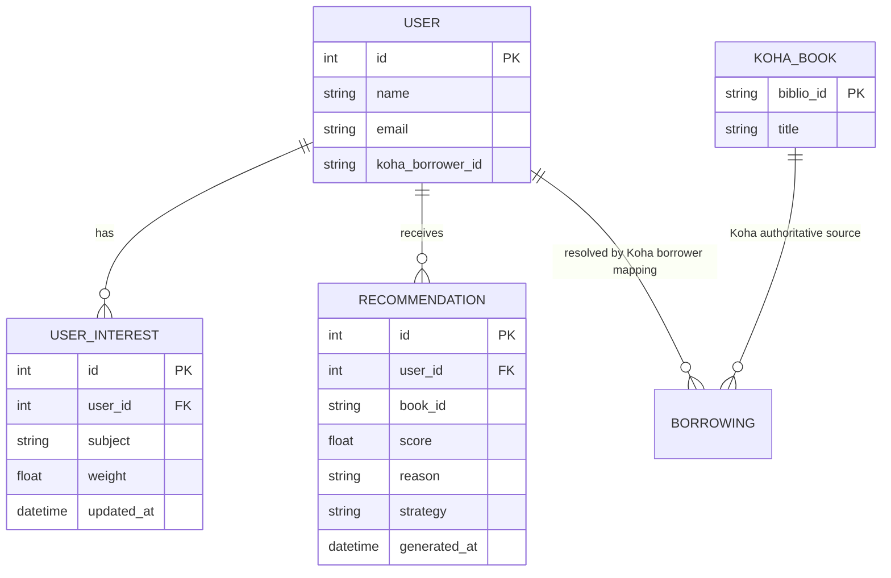
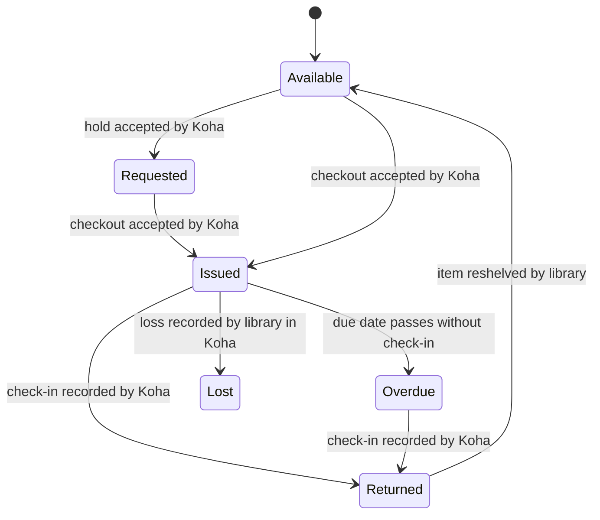

# Data model

Koha owns bibliographic records, item availability, patron identity and circulation. Portal SQLAlchemy tables are deliberately narrow:

`KOHA_BOOK` and `BORROWING` in the diagram describe external Koha resources, not local tables. The current local SQL schema contains `users`, `user_interests`, and `recommendations`; the sample user's borrower mapping is only populated in demo mode. Schema creation is currently at application startup; Alembic migrations remain a delivery task.

## Loan states

Koha controls these transitions. The portal displays observed circulation status and does not implement circulation state changes.

